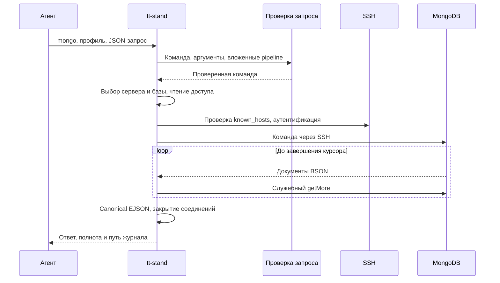

# Как устроен tt-stand

Путь вызова, раскладка кода и два правила, из которых следует остальное.
Правила работы с репозиторием — в [AGENTS.md](../AGENTS.md).

## Как устроено

Обычный вызов команды проходит путь: разбор аргументов → выполнение команды →
сборка ответа → запись в журнал → печать. По умолчанию ответ — один документ JSON, с `--human` он человекочитаемый.
`update` отвечает текстом. Справка `--help` и запуск без команды выводят текст справки. Признак полноты
известен только после того, как источник закончил отвечать, поэтому по частям его
отдавать нельзя.

Инструмент запускает `git` в команде `image` и `npm` в команде `update`. При exec-аутентификации
Kubernetes библиотека запускает программу, указанную в kubeconfig.
К Grafana он обращается по HTTP или HTTPS согласно схеме адреса `grafana.baseUrl`.
Протокол Kubernetes API определяется схемой адреса сервера в kubeconfig.

MongoDB использует Node-драйвер и SSH-клиент внутри процесса. Для запроса создаётся
локальный SOCKS-прокси на выделенном ОС порту с одноразовыми значениями доступа.
Все TCP-соединения драйвера, включая обнаруженные узлы replica set, проходят через
SSH forwardOut. Проверка known_hosts обязательна. SRV/TXT-разрешение выполняется
локально драйвером. TLS проверяет исходные имена узлов MongoDB.

| Часть                                                              | За что отвечает                                                                                              |
| ------------------------------------------------------------------ | ------------------------------------------------------------------------------------------------------------ |
| `src/cli.ts`, `src/cli/`                                           | разбор аргументов, выбор команды, конверт отказа                                                             |
| `src/commands/`                                                    | команды `logs`, `metrics`, `env`, `k8s`, `mongo`, `image`, `token`, `config`, `configInit`, `init`, `update` |
| `src/batch/`                                                       | подготовка и выполнение `batch`, сохранение полных ответов и построение отчёта                               |
| `src/skills/`                                                      | установка скилла (`updater*.ts` — копия общего шаблона, локально не правится) и её подключение (`setup.ts`)  |
| `src/config.ts`, `src/credentials.ts`, `src/paths.ts`              | файл конфигурации, доступы к Grafana, раскрытие путей                                                        |
| `src/grafana.ts`                                                   | HTTP к Grafana и построчный разбор ответа по мере поступления                                                |
| `src/environment.ts`                                               | определение namespace записи и сводка по окружениям                                                          |
| `src/http.ts`, `src/token.ts`                                      | разбор строки веб-трафика и декодирование токенов                                                            |
| `src/k8s/`                                                         | kubeconfig, состав кластера, чтение объектов, история выкаток                                                |
| `src/mongo/`                                                       | проверка стандартных команд, SSH, known_hosts, MongoDB-курсор и BSON                                         |
| `src/configSchemas.ts`, `src/profileServers.ts`, `src/profiles.ts` | серверы SSH/MongoDB, умолчания полей и выбор профиля                                                         |
| `src/lock.ts`                                                      | атомарная запись и межпроцессные блокировки локального состояния                                             |
| `src/response.ts`, `src/errors.ts`                                 | форма ответа, классы отказов, причины неполноты                                                              |
| `src/journal.ts`                                                   | запись вызова и ответа в журнал                                                                              |

Правило простое: в `commands/` лежит по файлу на каждую команду `tt-stand`, в остальных
файлах — то, чем эти команды пользуются.

Два правила, из которых следует остальное.

**Полнота считается, а не предполагается.** Каждый шаг, который мог потерять данные —
упор в лимит, нечитаемая строка, оборванный поток, недоступная группа Kubernetes,
неопределённый namespace, — добавляет причину в общий перечень. Пустой результат
с непустым перечнем означает «не нашли и не факт, что нечего было находить».

**Инструмент ничего не решает за пользователя.** Лимиты, границы периода и выражение
запроса уходят в источник как даны; порядок записей сохраняется как отдал сервер;
данные не сокращаются и не скрываются. Всё, что инструмент добавил от себя, названо
в `echo` рядом с ответом.

## Жизненный цикл MongoDB

Проверенный документ команды хранится внутри модуля подготовки. Исполнение принимает
только результат этой подготовки. Реестры команд, полей, фильтров, выражений и стадий
закрыты. Вложенные агрегации проходят ту же проверку, JavaScript и стадии записи
отклоняются до открытия соединения.

## Параллельные вызовы

Каждый процесс владеет выбранными профилем, базой, клиентами и курсорами.
Зависимый следующий запрос строит агент по результату предыдущего. Независимые
источники работают одновременно. Завершение вызова закрывает его ресурсы.

Журнал публикуется атомарным переименованием. Имя содержит время, PID и UUID.
Блокировки защищают создание профилей и работу реестра скиллов. Сетевые запросы
выполняются вне этих блокировок. `TT_STAND_RUN` служит меткой расследования.

Интеграционные тесты создают собственные SSH-ключи, локальную MongoDB и учётную
запись с правами записи. Проверки пользовательского подключения выполняются
через CLI, а состояние секретов проверяется через `config --json`.
